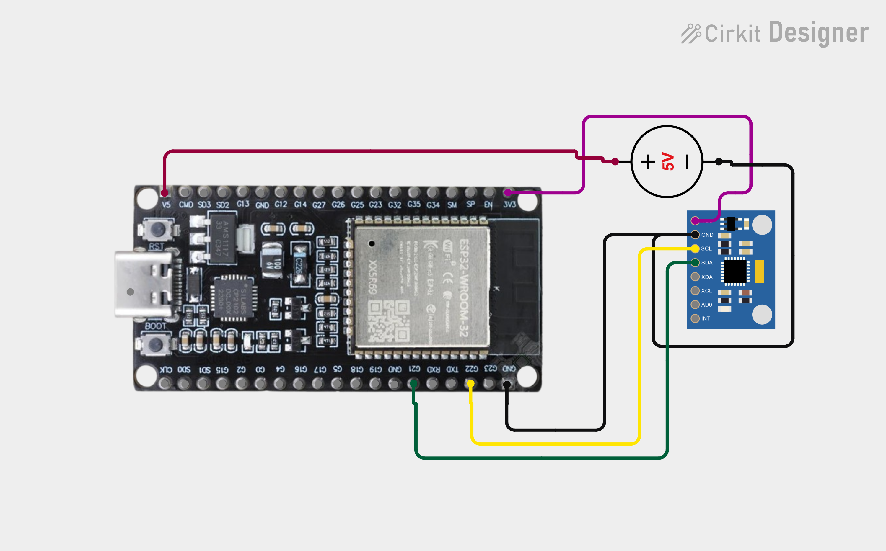
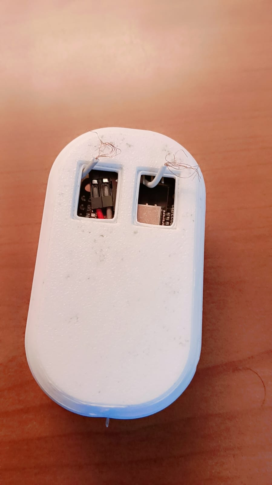
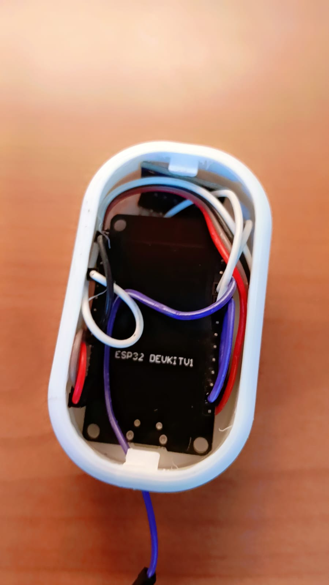
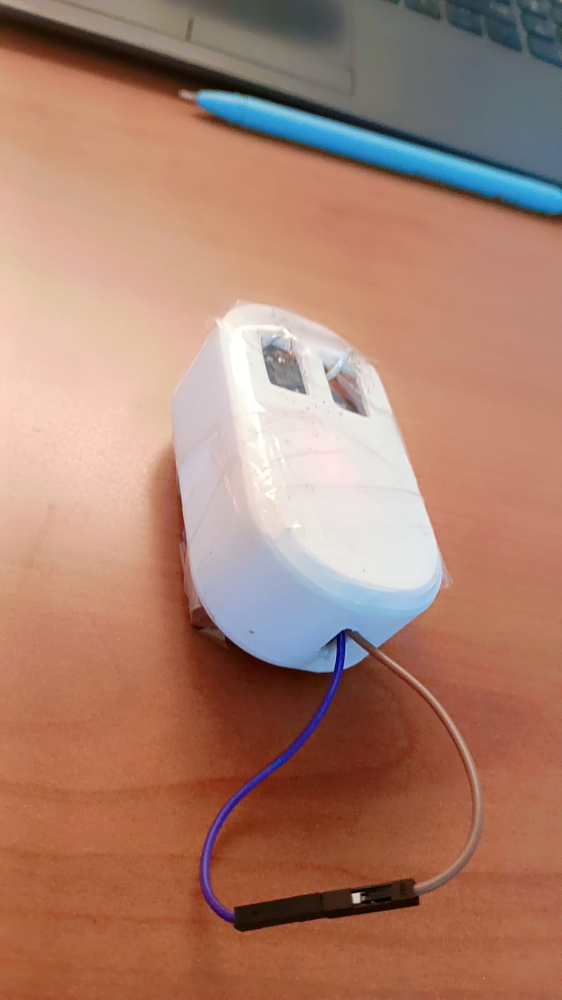

# 🖱️ ESP32 Air Mouse

A DIY wireless air mouse built using an **ESP32-WROOM-32** and an **MPU6050 gyroscope/accelerometer**. This project allows you to control your computer's cursor through hand movements, eliminating the need for a conventional physical mouse.

The ESP32 reads motion data from the MPU6050, processes the gyroscope readings, and transmits cursor movements and mouse clicks to a computer using **Bluetooth Low Energy (BLE) HID**.

---

## ✨ Features

- **Motion-Based Cursor Control:** Control your computer's cursor by moving the device through the air.
- **Wireless Connectivity:** Uses Bluetooth Low Energy (BLE) for wireless communication.
- **Left & Right Click:** Dedicated capacitive touch inputs for mouse clicks.
- **Gyroscope Calibration:** Automatically calibrates the MPU6050 during startup.
- **Noise Filtering:** Implements deadzone and low-pass filtering to minimize unwanted cursor movement.
- **Adjustable Sensitivity:** Cursor responsiveness can be customized through software parameters.
- **Compact Hardware:** Built around the ESP32-WROOM-32 development board.

---

## 🛠️ Hardware Components

| Component | Purpose |
|---|---|
| ESP32-WROOM-32 | Main microcontroller and BLE communication |
| MPU6050 | Gyroscope and accelerometer for motion detection |
| Touch Inputs | Left and right mouse button controls |
| Connecting Wires | Hardware connections |
| Power Source | Powers the device |

---

## 📁 Project Structure

```text
air-mouse/
│
├── code/
│   └── air_mouse_code_file.ino
│
├── circuit/
│   └── circuit_image.png
│
├── model_images/
│   ├── air_mouse_image_1.jpeg
│   ├── air_mouse_image-2.jpeg
│   └── air_mouse_image_3.jpeg
│
└── README.md
```

---

## 🔌 Circuit Connections

### MPU6050 to ESP32

| MPU6050 Pin | ESP32 GPIO |
|---|---|
| SDA | GPIO 21 |
| SCL | GPIO 22 |
| GND | GND |
| VCC | Compatible power supply |

### Touch Inputs

| Function | ESP32 GPIO |
|---|---|
| Left Click | GPIO 32 |
| Right Click | GPIO 33 (recommended) |

### Circuit Diagram



**Important:** The current firmware defines the right touch input as GPIO35. However, GPIO35 on the classic ESP32-WROOM-32 does not support capacitive touch sensing. Change `RIGHT_TOUCH_PIN` to GPIO33 and connect the right touch input accordingly before testing.

---

## 💻 Software Requirements

- Arduino IDE
- ESP32 Board Package
- HijelHID_BLEMouse Library
- MPU6050_light Library

The project also uses the standard Arduino `Wire.h` and C++ `math.h` libraries.

---

## 🚀 Getting Started

### 1. Install Arduino IDE

Download and install the Arduino IDE:

https://www.arduino.cc/en/software

### 2. Configure ESP32

Install ESP32 board support through the Arduino Boards Manager.

Select your ESP32 development board.

### 3. Install Required Libraries

Install the following libraries:

- `HijelHID_BLEMouse`
- `MPU6050_light`

### 4. Connect the Hardware

Connect the MPU6050 and touch inputs to the ESP32 according to the circuit diagram.

Make sure the right touch input is connected to a touch-capable GPIO.

### 5. Upload the Firmware

1. Open `code/air_mouse_code_file.ino`.
2. Select the appropriate ESP32 board.
3. Select the correct serial port.
4. Upload the firmware.

### 6. Calibrate the Device

Open the Serial Monitor at **115200 baud**.

During startup:

- The MPU6050 gyroscope calibration runs.
- Keep the device stationary during calibration.
- Touch inputs are calibrated automatically.
- Do not touch the input pads while touch calibration is running.

### 7. Connect via Bluetooth

1. Enable Bluetooth on your computer.
2. Search for available Bluetooth devices.
3. Find **ESP32 Air Mouse**.
4. Pair and connect to the device.

Your ESP32 should now function as a wireless Bluetooth mouse.

---

## ⚙️ How It Works

### 1. Motion Detection

The MPU6050 measures angular velocity along its X, Y and Z axes.

The ESP32 communicates with the sensor using the I²C protocol and continuously reads gyroscope measurements.

### 2. Gyroscope Calibration

At startup, the firmware calls:

```cpp
mpu.calcGyroOffsets();
```

This calculates gyroscope offsets to compensate for sensor bias.

The device should remain stationary during calibration.

### 3. Motion Processing

Raw gyroscope readings are processed using two filtering techniques.

**Deadzone Filtering**

Small movements below a predefined threshold are ignored to reduce unwanted cursor movement.

**Low-Pass Filtering**

A low-pass filter smooths the sensor readings and reduces sudden cursor movements.

The filtered readings are converted into mouse cursor displacement.

### 4. Cursor Movement

The firmware converts gyroscope readings into horizontal and vertical mouse movements:

```cpp
int moveX = (int)(sensitivity * smoothY);
int moveY = (int)(-sensitivity * smoothX);
```

The resulting movements are transmitted through BLE HID.

### 5. Touch-Based Clicking

The ESP32 uses capacitive touch inputs to detect left and right clicks.

During startup, the firmware measures baseline touch values and calculates individual thresholds.

When a touch is detected, the corresponding mouse button state is transmitted to the computer.

### 6. Bluetooth HID Communication

The `HijelHID_BLEMouse` library allows the ESP32 to behave like a standard Bluetooth mouse.

The computer receives mouse movement and button events without requiring a dedicated receiver.

---

## 🎛️ Customization

The following parameters can be adjusted in the Arduino firmware:

```cpp
const float gyroDeadzone = 2.0;
const float filterAlpha = 0.2;
const float sensitivity = 0.25;
```

| Parameter | Description |
|---|---|
| `gyroDeadzone` | Controls the minimum gyroscope reading required to register movement. |
| `filterAlpha` | Controls the responsiveness of the low-pass filter. |
| `sensitivity` | Controls cursor movement speed. |

### Tuning Guide

- Increase `sensitivity` for faster cursor movement.
- Decrease `sensitivity` for finer cursor control.
- Increase `gyroDeadzone` to reduce unwanted movement.
- Decrease `filterAlpha` for smoother but slower responses.

---

## 📸 Project Gallery

### Hardware Prototype







---

## ⚠️ Current Limitations

- Cursor movement relies on gyroscope measurements rather than absolute position tracking.
- Gyroscope calibration is required during startup.
- Sensor noise and drift can affect cursor accuracy.
- Touch inputs require appropriate touch-capable ESP32 GPIO pins.
- Bluetooth performance depends on the host computer and BLE compatibility.

---

## 🔮 Future Improvements

Potential improvements include:

- Improved motion tracking and drift compensation.
- Adjustable cursor sensitivity through touch controls.
- Gesture recognition.
- Battery monitoring and optimization.
- Scroll functionality.
- Multiple operating modes.
- Improved touch calibration.

---

## 🧰 Technologies Used

| Technology | Application |
|---|---|
| C++ | Firmware development |
| Arduino IDE | Development environment |
| ESP32 | Embedded processing |
| MPU6050 | Motion sensing |
| I²C | Sensor communication |
| Bluetooth Low Energy | Wireless communication |
| BLE HID | Mouse emulation |

---

## 👨‍💻 Author

Developed as an embedded systems and hardware-software integration project.

**Built with ESP32, MPU6050, Arduino and Bluetooth Low Energy.**

---
